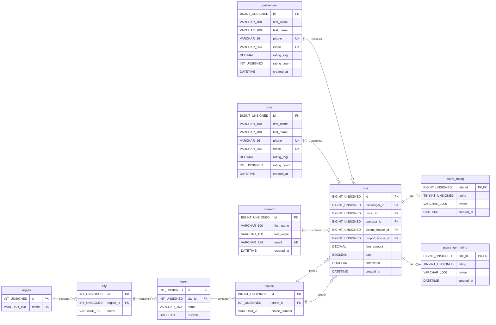

# Uber MySQL

Educational MySQL database project.

## Requirements
- MySQL 8.0.18+ (InnoDB, utf8mb4); CHECK constraints require MySQL 8.0.16+.
- Linux with GNU Make.
- MySQL CLI tools: mysql, mysql_config_editor.
- A local MySQL administrator account (by default, sudo mysql).

Local development only. The Makefile creates the MySQL account
'uber'@'localhost' with ALL PRIVILEGES on uber.*, not on the entire
MySQL server. This account is not equivalent to MySQL root.

## Database Schema (ERD)




## Relationships

- region → city → street → house: One-to-Many.
- passenger → ride: One-to-Many.
- driver → ride: One-to-Many (driver optional).
- operator → ride: One-to-Many (operator optional).
- house → ride: One-to-Many for pickup and dropoff.
- ride → driver_rating / passenger_rating: One-to-Zero-or-One.
- Foreign keys use RESTRICT for DELETE and UPDATE.

## Business Rules

- Regions include oblasts and special-status cities.
- Names are unique within their parent region or city; house numbers within a street.
- Every child address entity requires a parent.
- drivable indicates car accessibility.
- Passenger and driver phones are required, unique within their respective tables, and E.164-formatted; emails are optional and unique when provided.
- Each ride requires a passenger, pickup and dropoff addresses.
- Driver and operator assignments are optional; completed rides require a driver.
- Rides must be paid before they can be marked as completed.
- Ratings range from 1 to 5; each ride permits one rating per direction.
-Ratings belong to completed rides and are submitted by the opposite party.
- Passenger and driver average ratings are cached from their rating tables; unrated users have NULL averages.

## Quick start

Initialize the local MySQL environment:

```bash
make setup
```
The setup creates the MySQL user, database, tables,
and development data, then verifies the result.

Save the generated password and enter it when prompted.
If the user already exists, use its existing password.

## Commands
```bash
make help      # List available commands
make verify    # Check tables and sample data
make seed      # Insert development data
make reset     # Remove database, user, and saved login
```
*make reset* permanently deletes the local database and
requires confirmation.