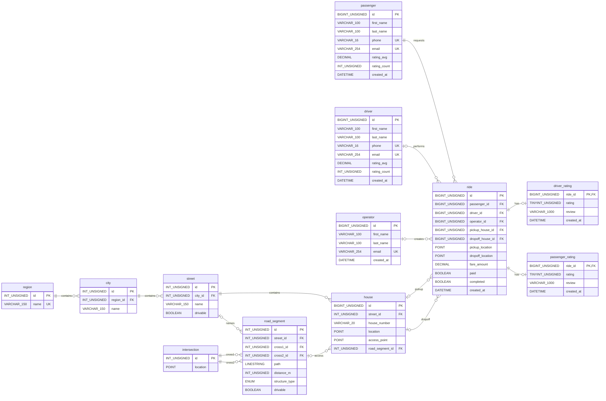

# Uber MySQL

Educational MySQL database project.

## Requirements
- MySQL 8.0.18+ (InnoDB, utf8mb4); CHECK constraints require MySQL 8.0.16+.
- Linux with GNU Make.
- MySQL CLI tools: mysql, mysql_config_editor.
- A local MySQL administrator account (by default, sudo mysql).

Local development only. The Makefile creates the MySQL account
'uber'@'localhost' with ALL PRIVILEGES on uber.*, not on the entire
MySQL server. This account is not equivalent to MySQL root.

## Database Schema (ERD)




## Relationships

- region → city → street → house: One-to-Many.
- intersection → road_segment: One-to-Many per endpoint.
- street → road_segment: One-to-Many (optional).
- road_segment → house: One-to-Many (optional access).
- passenger / driver / operator → ride: One-to-Many.
- house → ride: One-to-Many (optional pickup/dropoff).
- ride → driver_rating / passenger_rating: One-to-Zero-or-One.
- Foreign keys use RESTRICT for DELETE and UPDATE.

## Business Rules

- Regions include oblasts and special-status cities.
- Names are unique within their parent; house numbers within a street.
- Address entities require their parent.
- Road segments connect different intersections and have positive distances.
- Segments may be roads, bridges, or tunnels; routing respects drivable.
- Houses may store location and road-access coordinates.
- Every ride requires pickup and dropoff coordinates; house references are optional.
- Completed rides require an assigned driver and payment.
- Ratings are 1–5, one per direction per ride; averages are cached.
- River-crossing routes use exactly one designated bridge.

## Quick start

Initialize the local MySQL environment:

```bash
make setup
```
The setup creates the MySQL user, database, tables,
and development data, then verifies the result.

Save the generated password and enter it when prompted.
If the user already exists, use its existing password.

## Commands
```bash
make help      # List available commands
make verify    # Check tables and sample data
make seed      # Insert development data
make reset     # Remove database, user, and saved login
```
*make reset* permanently deletes the local database and
requires confirmation.