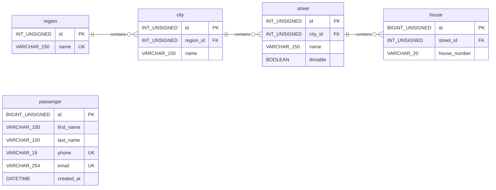

# Uber MySQL

Educational MySQL database project.

## Requirements
- MySQL 8.0.18+ (InnoDB, utf8mb4); CHECK constraints require MySQL 8.0.16+.
- Linux with GNU Make.
- MySQL CLI tools: mysql, mysql_config_editor.
- A local MySQL administrator account (by default, sudo mysql).

Local development only. The Makefile creates the MySQL account
'uber'@'localhost' with ALL PRIVILEGES on uber.*, not on the entire
MySQL server. This account is not equivalent to MySQL root.

## Database Schema (ERD)




## Relationships

- region → city: One-to-Many
- city → street: One-to-Many
- street → house: One-to-Many
- passenger: Independent entity (no relationships yet).
- Foreign keys use RESTRICT for DELETE and UPDATE.

## Business Rules

- Regions include oblasts and special-status cities.
- Region names are unique within the current country scope.
- City names are unique within a region.
- Street names are unique within a city.
- House numbers are unique within a street.
- Every child entity requires a parent.
- drivable indicates basic car accessibility.
- Passenger phone numbers are required, unique, and E.164-formatted.
- Passenger emails are required and unique.
- Passenger names must be non-empty.

## Quick start

Initialize the local MySQL environment:

```bash
make setup
```
The setup creates the MySQL user, database, tables,
and development data, then verifies the result.

Save the generated password and enter it when prompted.
If the user already exists, use its existing password.

## Commands
```bash
make help      # List available commands
make verify    # Check tables and sample data
make seed      # Insert development data
make reset     # Remove database, user, and saved login
```
*make reset* permanently deletes the local database and
requires confirmation.